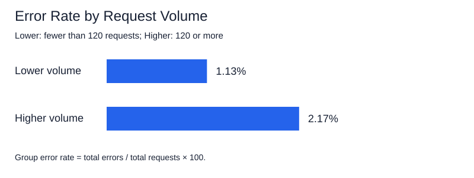

# Service Reliability and Request Volume

Continuous Intelligence | Project 03 | Darrion Maurice Stringer

Author: Darrion Maurice Stringer
Date: 2026-11

## Overview

I investigated whether service reliability differs between observations with lower and higher request volumes.

I used the example system metrics and added a success-rate signal. Then I grouped the observations by request volume and compared error rates, success rates, and average response times.

## Data

The provided example dataset contains 10 observations with three measurements:

- requests: number of requests handled.
- errors: number of failed requests.
- total_latency_ms: total response time in milliseconds.

[View Dataset](https://github.com/dstringer03/cintel-03-signal-design-custom/blob/main/data/system_metrics.csv)

## Methods

I used Python and Polars to load the CSV, calculate signals, group observations, and save the results.

Before calculating the comparisons, the script checks for required columns, missing values, negative measurements, and error counts greater than request counts.

### Signals

- Error rate = errors / requests.
- Success rate = (requests - errors) / requests.
- Average latency = total_latency_ms / requests.
- Request volume = requests per observation.

For my D2 experiment, I added success_rate. I predicted values between 97.5% and 100%, and the results matched that prediction.

When requests are zero, the added success-rate signal is null because there are no requests to evaluate. This dataset contains no zero-request observations.

### Volume Groups

I chose 120 requests as the comparison cutoff:

- Lower volume: fewer than 120 requests.
- Higher volume: 120 requests or more.

This gives five observations in each group. The cutoff is an analytical choice, not an established performance standard.

### Group Calculations

I calculated each group's error rate using total errors divided by total requests.

Group success rate uses total successful requests divided by total requests.

Group average latency uses total latency divided by total requests.

These calculations weight the results by request counts rather than averaging the individual observation rates.

## Results

| Measure | Lower volume | Higher volume |
|---|---:|---:|
| Observations | 5 | 5 |
| Total requests | 443 | 785 |
| Total errors | 5 | 17 |
| Error rate | 1.13% | 2.17% |
| Success rate | 98.87% | 97.83% |
| Average latency | 29.12 ms | 30.70 ms |

[View Signals by Volume Group](https://github.com/dstringer03/cintel-03-signal-design-custom/blob/main/artifacts/volume_signals.csv)

[View Group Comparison](https://github.com/dstringer03/cintel-03-signal-design-custom/blob/main/artifacts/volume_comparison.csv)

## Interpretation

The higher-volume group had a higher error rate and slightly slower average responses.

Its error rate was about 2.17%, compared with 1.13% for the lower-volume group. Average response time was about 30.70 milliseconds, compared with 29.12 milliseconds.

This suggests an association between higher request volume and poorer performance in this small dataset. It does not prove that request volume caused the differences.

I learned why rates are useful. Comparing 17 errors with 5 errors alone would ignore the different numbers of requests handled by each group.

## Limitations

- The dataset contains only 10 observations.
- The 120-request cutoff was chosen for this comparison.
- Other factors that could affect performance are not included.
- The analysis does not establish acceptable performance thresholds.
- Request counts are not normalized by elapsed time. Comparing them as workload levels assumes comparable observation intervals.
- The reactive app remains the example interface; this custom comparison runs through volume_analysis.py.

## Next Steps

If I continued this project, I would collect more observations with timestamps and equal measurement intervals. I would also try different grouping cutoffs to see whether the finding remains consistent.

## Run the Project

From the project root, run the original signal pipeline:

    uv run python -m cintel.signal_design

Run my custom volume comparison:

    uv run python -m cintel.volume_analysis

The custom script saves two CSV files in artifacts/ and generates the chart in docs/images/.

## Verification

The custom script ran successfully and produced two groups of five observations.

I checked the group calculations:

- Lower-volume error rate: 5 / 443 × 100 = approximately 1.13%.
- Higher-volume error rate: 17 / 785 × 100 = approximately 2.17%.

## Project Links

- [GitHub Repository](https://github.com/dstringer03/cintel-03-signal-design-custom)
- [Custom Analysis Code](https://github.com/dstringer03/cintel-03-signal-design-custom/blob/main/src/cintel/volume_analysis.py)
- [Results and Artifacts](https://github.com/dstringer03/cintel-03-signal-design-custom/tree/main/artifacts)
- [D2 Experiment](https://github.com/dstringer03/cintel-03-signal-design-custom/blob/main/README.md#d2-experiment-adding-success-rate)

## Documentation Index

- [Project Instructions](project-instructions.md)
- [Glossary](glossary.md)
- [API](api.md)
- [Reactive App](./app/index.html)

## Resources

Based on the example project by Denise Case.

- [Original Example Repository](https://github.com/denisecase/cintel-03-signal-design)
- [Professional Python Guide](https://denisecase.github.io/pro-analytics-02/)
